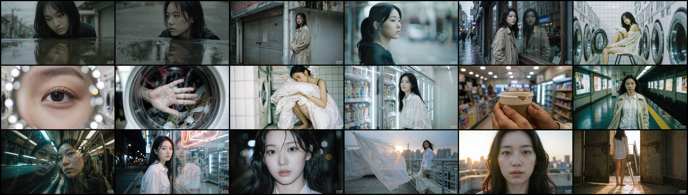

<div align="center">

# AI Video Cases

**用 WorkBuddy 内置模型（ImageGen + VideoGen）从零生成电影感短片 · 可复现管线 · 实战踩坑笔记**

[](https://github.com/kedamano/AI_Video_cases/stargazers)
[](https://github.com/kedamano/AI_Video_cases/commits/main)
[](https://github.com/kedamano/AI_Video_cases)
[](#案例-01--玻璃之后)
[](#案例-01--玻璃之后)
[](#案例-01--玻璃之后)

[成品](#成品) · [快速开始](#快速开始) · [复现管线](#复现管线) · [踩坑笔记](#踩坑笔记) · [案例](#案例-01--玻璃之后)

</div>



---

## 这是什么

这是一个 **AI 短片生产案例库**：把一个创意从「分镜脚本」一路做到「可直接播放的成片」，全流程只用 WorkBuddy 自带的两个模型 —— `ImageGen` 生首帧、`VideoGen` 图生视频 —— 再用 ffmpeg 按分镜时长剪成片。

不接任何第三方生图/生视频服务（Pollinations、LibTV 等），只消耗 WorkBuddy 积分。每个案例都附带**完整参数、可运行脚本和踩过的坑**，你可以照着复现，也可以换成自己的故事。

## 目录

- [这是什么](#这是什么)
- [特性](#特性)
- [快速开始](#快速开始)
- [复现管线](#复现管线)
- [仓库结构](#仓库结构)
- [案例 01 · 玻璃之后](#案例-01--玻璃之后)
- [踩坑笔记](#踩坑笔记)
- [版本与留档](#版本与留档)
- [路线图](#路线图)
- [贡献](#贡献)
- [许可](#许可)

## 特性

- **端到端可复现** —— 从分镜表到成片，每一步都有对应文件和命令，不是「效果展示」而是「生产线」。
- **零第三方依赖** —— 生图生视频全部走 WorkBuddy 内置模型，不吃外部 API 额度。
- **分镜驱动的时长控制** —— 18 个镜头按秒级时间轴硬切，成片严格 25.00s，不是靠模型自由发挥。
- **已验证的面部一致性方案** —— 同一角色跨 18 镜不崩脸、不发灰，附固定提示词词块。
- **大文件用 Git LFS** —— 视频原片与成片走 LFS，clone 后 `git lfs pull` 即可拿到全部素材。
- **一条命令出片** —— `python make_final.py` 自动 trim → concat → 混音。

## 快速开始

```bash
# 1. 克隆（视频在 LFS 里，必须拉取）
git clone https://github.com/kedamano/AI_Video_cases.git
cd AI_Video_cases
git lfs pull

# 2. 直接看成片
#    macOS:  open 玻璃之后_成片.mp4
#    Windows: start 玻璃之后_成片.mp4

# 3. 从现有素材重新出片（需要 ffmpeg）
pip install imageio-ffmpeg
python make_final.py
```

`make_final.py` 会优先使用 `imageio-ffmpeg` 自带的 ffmpeg，找不到时回退到系统 `PATH` 中的 `ffmpeg`，因此**无需预装 ffmpeg**。

## 复现管线

```
① 分镜脚本            ② 首帧生图              ③ 图生视频              ④ 拼装成片
玻璃之后_视频脚本提示词.html → frames/shotNN.png → videos/shotNN.mp4 → 玻璃之后_成片.mp4
   （画面/运动/时长）      ImageGen 1280×720       VideoGen 5s / 1080p      ffmpeg trim+concat+mix
```

**② 首帧生图**

```text
WorkBuddy ImageGen
  size    = 1280x720
  quality = medium
  prompt  = 场景描述 + CLEAN BEAUTY 词块（见下方踩坑笔记）
```

**③ 图生视频**

```text
WorkBuddy VideoGen
  image        = frames/shotNN.png   # 传入首帧即进入图生视频模式
  seconds      = 5
  enable_audio = false               # 音轨统一在 ④ 阶段合成
  # 注意：不要传 aspect_ratio，画幅由首帧决定，传了会报错
```

**④ 拼装成片**

```bash
python make_final.py
```

脚本内部做三件事：按 `DUR = [2,1,2,1,1,2,1,1,2,1,1,2,1,1,2,1,1,2]` 逐段 trim 并统一到 1920×1080 / 24fps → concat 硬切 → 叠加棕噪雨声与 220/329.63Hz 正弦底垫并淡入淡出。

## 仓库结构

```text
.
├── README.md
├── 玻璃之后_视频脚本提示词.html   # 18 镜分镜脚本（画面/运动/时长/色调/BGM）
├── make_final.py                  # 拼装 + 混音，一条命令出片
├── frames/
│   └── shot01–18.png              # WorkBuddy ImageGen 首帧
├── videos/
│   └── shot01–18.mp4              # WorkBuddy VideoGen 图生视频原片（LFS）
├── 玻璃之后_成片.mp4               # 成品 25s / 1080p（LFS）
├── contact_sheet.png              # 18 镜首帧总览
└── 成片抽帧核对.png                # 成片逐镜抽帧校验图
```

## 案例 01 · 玻璃之后

> 都市纪实电影感 · 真实摄影 · 一个雨夜到清晨的独处切片

### 成品

| 项目 | 参数 |
| --- | --- |
| 时长 | 25.00 s |
| 画幅 | 1920×1080（16:9） |
| 帧率 | 24 fps |
| 编码 | H.264 + AAC 立体声 |
| 体积 | 约 23 MB |
| 镜头数 | 18 |
| 色调 | 青灰冷调 → 暖金逆光 |

### 分镜时间轴

| # | 时长 | 画面 |
| --- | --- | --- |
| 01 | 2s | 雨后街道水洼，俯拍倒影，一滴水砸碎水面 |
| 02 | 1s | 水面倒影里她的脸逐渐清晰 |
| 03 | 2s | 撑透明伞走过半降的旧卷帘门 |
| 04 | 1s | 隔着橱窗玻璃的侧脸，呼出白气 |
| 05 | 1s | 玻璃前抬手别发，倒影慢半拍 |
| 06 | 2s | 24h 洗衣店，坐在塑料椅上 |
| 07 | 1s | 眼部特写，瞳孔里一点暖黄光斑 |
| 08 | 1s | 手掌贴在滚筒洗衣机的圆形玻璃门上 |
| 09 | 2s | 抱着一团烘干的床单把脸埋进去 |
| 10 | 1s | 便利店冷柜前，冷气涌出拂过脸 |
| 11 | 1s | 纸杯咖啡的热气被吹散又聚拢 |
| 12 | 2s | 深夜空站台，进站的风掀起头发 |
| 13 | 1s | 车窗玻璃上的双重影像，隧道灯掠过 |
| 14 | 1s | 霓虹下隔玻璃触碰"另一个自己" |
| 15 | 2s | 深夜街头正面特写，直视镜头 |
| 16 | 1s | 天台床单在风里翻卷，只剩发光剪影 |
| 17 | 1s | 晨光从脸颊漫到整张脸，瞳孔收缩 |
| 18 | 2s | 走向铁门，门后白光吞掉整个画面 |

### 关键设计

- **硬切不转场**：18 段全部直接拼接，靠时长节奏（2/1/2/1/1…）制造呼吸感，避免花哨转场破坏纪实感。
- **音效后置**：视频阶段全部 `enable_audio=false`，统一在拼装阶段叠雨声与低频垫，保证 18 段音轨绝对连续。
- **同角色跨镜一致**：所有含脸镜头共用同一段 `CLEAN BEAUTY` 描述词块，靠提示词而非参考图锁脸。

## 踩坑笔记

这部分是本仓库最值钱的内容 —— 都是实际撞墙后验证过的结论。

| # | 问题 | 现象 | 解法 |
| --- | --- | --- | --- |
| 1 | 「真实感」提示词把脸画脏 | 写了 `visible freckles` / `fine skin pores` / `real skin texture` / `no beauty retouch`，人物面部灰浊、油高光、颗粒叠满 | 换成固定词块 `CLEAN BEAUTY face`（见下方），并加 `clean image, no CGI` |
| 2 | `ImageGen` 并行出图目录被合并 | 即使给每张传不同 `output_dir`，也会落到同一目录，文件名只按 prompt 前缀派生 | 单批 ≤3 张；每张 prompt 用不同前置词（`Window profile:` / `Eye macro:` / `Night portrait:`）避免前缀撞车；生成后按返回的 `localPath` 精确改名，别靠文件名猜 |
| 3 | `VideoGen` 图生视频不接受 `aspect_ratio` | 传了就报错 | 图生视频时画幅由输入首帧决定，删掉该参数即可 |
| 4 | 无脸镜头也会「脏」 | 只修特写镜头后，水洼/手部/剪影镜头仍然灰浊发闷 | 「脏感」= 整体灰阶 + 重颗粒，不是只存在于脸；**全 18 镜都需统一重出** |
| 5 | 大文件推不上 GitHub | 单个 mp4 虽 <100MB，但总量数百 MB | 用 Git LFS 跟踪 `*.mp4`，clone 端需 `git lfs pull` |

### CLEAN BEAUTY 词块（可直接复用）

```text
CLEAN BEAUTY face - flawless porcelain fair skin, perfectly even tone,
matte finish with zero oily sheen, no freckles, no blemishes, no dirt,
no blotchy patches, refined delicate features, sculpted nose bridge,
neatly shaped straight brows, natural dusty-rose lips,
glossy black hair smooth and softly wavy, clean luminous complexion
```

> `ImageGen` 没有 `negative_prompt` 参数，负面词只能写进正向 prompt；`VideoGen` 虽有该参数，直接写在 prompt 末尾同样生效。

## 版本与留档

| 版本 | 内容 | 状态 |
| --- | --- | --- |
| v1 | 原始版，面部脏感重 | 本地留档，不入库 |
| v2 | 仅修复 7 个面部特写镜头 | 本地留档，不入库 |
| **v3（当前）** | **18 镜全部按 CLEAN BEAUTY 重出，全片统一** | 已入库 |

## 路线图

- [x] 案例 01 全流程跑通（脚本 → 首帧 → 视频 → 成片）
- [x] 18 镜面部质感统一
- [x] Git LFS 托管视频资产
- [ ] 增加 9:16 竖版重制（短视频平台适配）
- [ ] 补充真实环境音采样替代合成底噪
- [ ] 片尾叠加片名字幕
- [ ] 新增案例 02：多角色对话场景

## 贡献

欢迎提 Issue 分享你的踩坑，或直接 PR 新案例。新增案例请遵循：

1. 独立子目录，内含 `脚本.html`、`make_final.py`、`frames/`、`videos/`、成片；
2. 在 [案例](#案例-01--玻璃之后) 区追加一节，写清参数与踩坑；
3. 视频走 Git LFS，不要把大文件直接提交进 Git 历史。

## 许可

本仓库暂未声明开源协议。素材与提示词仅供学习参考，商用请联系作者。

---

<div align="center">

如果这个案例对你有帮助，点个 ⭐ **Star** 支持一下，也欢迎把它用在自己的短片里。

</div>
