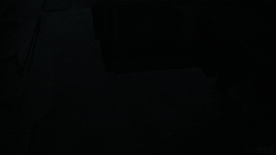

<div align="center">

# AI Video Cases

**AI 视频生成案例库 · 可复现管线 · 实战踩坑 · 方法论沉淀**

[](https://github.com/kedamano/AI_Video_cases/stargazers)
[](https://github.com/kedamano/AI_Video_cases/commits/main)
[](https://github.com/kedamano/AI_Video_cases)
[](#案例库)
[](#案例-01--玻璃之后)
[](#案例-01--玻璃之后)
[](#案例-02--沉没成本辩论)
[](#贡献)



*《玻璃之后》· 25 秒 / 18 镜 / 1920×1080 · 全流程由 WorkBuddy ImageGen + VideoGen 生成*

[案例库](#案例库) · [方法论](docs/methodology.md) · [踩坑笔记](#踩坑笔记) · [审片清单](#审片清单) · [工具索引](#工具与资源索引) · [快速开始](#快速开始)

</div>

---

> An open collection of AI video generation case studies — full storyboards, exact parameters, reproducible scripts, and the mistakes we actually made. English readers: start with [Case 01](#案例-01--玻璃之后).

## 这是什么

**这不是作品集，是生产线。**

打开任何一个案例，你能拿到的是：分镜脚本、每一镜的提示词、首帧图、视频原片、拼装脚本、成品，以及这一步为什么会失败。全部参数公开，没有「效果展示」式的藏私。

三条原则：

- **实测优先** —— 写进仓库的每个结论都在本项目里撞过，不是转述别人的经验。
- **可复现** —— `git clone` → `git lfs pull` → `python make_final.py`，三步出片。
- **只说有用的话** —— 没有「AI 很强大」这类空话，只有「传这个参数会报错」这类能省你两小时的话。

## 30 秒看懂

| 案例 | 规格 | 核心难点 | 状态 |
| --- | --- | --- | --- |
| [01 · 玻璃之后](#案例-01--玻璃之后) | 25s / 18 镜 / 1080p / 24fps | 同一角色跨 18 镜面部不崩、不脏 | ✅ 完成 |
| [02 · 沉没成本辩论](#案例-02--沉没成本辩论) | 120s / 10 场景 / 720p / 30fps | 纯代码场景化动画 + GSAP 时间线 + Vibe 知识大赏风格 | ✅ 完成 |
| [03 · 雨夜对谈](#案例-03--雨夜对谈) | 30s / 12 镜 / 720p / 24fps | 双角色对话场景，跨角色一致性与过肩镜头身份锁定 | ✅ 完成 |

## 为什么值得 Star

- **一条能跑起来的完整管线**，不是拼图式灵感：脚本 → 首帧 → 图生视频 → 按分镜表硬切 → 混音，每步都有对应文件。
- **18 个镜头的真实参数**：哪一镜用什么焦段、什么光位、什么运动描述，逐条可查。
- **7 条撞墙记录**：从「提示词把脸画脏」到「并行生图目录被合并」，都是花过钱、返过工的结论。
- **9 条审片清单**：把「感觉不对」变成可勾选的检查项。
- **16 个工具索引**：按任务而非星数选型，附每个工具解决的**具体**问题。

## 目录

- [这是什么](#这是什么) · [30 秒看懂](#30-秒看懂) · [为什么值得 Star](#为什么值得-star)
- [快速开始](#快速开始) · [复现管线](#复现管线)
- [案例库](#案例库) → [案例 01 · 玻璃之后](#案例-01--玻璃之后)
- [方法论](docs/methodology.md) · [踩坑笔记](#踩坑笔记) · [审片清单](#审片清单)
- [工具与资源索引](#工具与资源索引) · [仓库结构](#仓库结构)
- [版本与留档](#版本与留档) · [路线图](#路线图) · [贡献](#贡献) · [许可](#许可)

## 快速开始

```bash
# 1. 克隆（视频在 LFS 里，必须拉取）
git clone https://github.com/kedamano/AI_Video_cases.git
cd AI_Video_cases
git lfs pull

# 2. 直接看成片
#    macOS:  open 玻璃之后_成片.mp4
#    Windows: start 玻璃之后_成片.mp4

# 3. 从现有素材重新出片（不需要预装 ffmpeg）
pip install imageio-ffmpeg
python make_final.py
```

`make_final.py` 优先使用 `imageio-ffmpeg` 自带的二进制，找不到才回退系统 `PATH`。

## 复现管线

```
① 分镜脚本            ② 首帧生图              ③ 图生视频              ④ 拼装成片
玻璃之后_视频脚本提示词.html → frames/shotNN.png → videos/shotNN.mp4 → 玻璃之后_成片.mp4
   （画面/运动/时长）      ImageGen 1280×720       VideoGen 5s / 1080p      ffmpeg trim+concat+mix
```

**② 首帧生图**

```text
WorkBuddy ImageGen
  size    = 1280x720
  quality = medium
  prompt  = 场景描述 + CLEAN BEAUTY 词块（见踩坑笔记）
```

**③ 图生视频**

```text
WorkBuddy VideoGen
  image        = frames/shotNN.png   # 传入首帧即进入图生视频模式
  seconds      = 5
  enable_audio = false               # 音轨统一在 ④ 阶段合成
  # 不要传 aspect_ratio：画幅由首帧决定，传了会报错
```

**④ 拼装成片**

```bash
python make_final.py
```

内部做三件事：按 `DUR = [2,1,2,1,1,2,1,1,2,1,1,2,1,1,2,1,1,2]` 逐段 trim 并统一到 1920×1080 / 24fps → concat 硬切 → 叠加棕噪雨声与 220/329.63Hz 正弦底垫并淡入淡出。

## 案例库

### 案例 01 · 玻璃之后

> 都市纪实电影感 · 真实摄影 · 一个雨夜到清晨的独处切片

| 项目 | 参数 |
| --- | --- |
| 时长 / 画幅 / 帧率 | 25.00 s / 1920×1080（16:9） / 24 fps |
| 编码 / 体积 | H.264 + AAC 立体声 / 约 23 MB |
| 镜头数 | 18 |
| 单镜时长 | `2,1,2,1,1,2,1,1,2,1,1,2,1,1,2,1,1,2` |
| 色调 | 青灰冷调 → 暖金逆光 |
| 生成方式 | WorkBuddy `ImageGen` 首帧 + `VideoGen` 图生视频 |

<details>
<summary><b>展开 18 镜分镜时间轴</b></summary>

| # | 时长 | 画面 |
| --- | --- | --- |
| 01 | 2s | 雨后街道水洼，俯拍倒影，一滴水砸碎水面 |
| 02 | 1s | 水面倒影里她的脸逐渐清晰 |
| 03 | 2s | 撑透明伞走过半降的旧卷帘门 |
| 04 | 1s | 隔着橱窗玻璃的侧脸，呼出白气 |
| 05 | 1s | 玻璃前抬手别发，倒影慢半拍 |
| 06 | 2s | 24h 洗衣店，坐在塑料椅上 |
| 07 | 1s | 眼部特写，瞳孔里一点暖黄光斑 |
| 08 | 1s | 手掌贴在滚筒洗衣机的圆形玻璃门上 |
| 09 | 2s | 抱着一团烘干的床单把脸埋进去 |
| 10 | 1s | 便利店冷柜前，冷气涌出拂过脸 |
| 11 | 1s | 纸杯咖啡的热气被吹散又聚拢 |
| 12 | 2s | 深夜空站台，进站的风掀起头发 |
| 13 | 1s | 车窗玻璃上的双重影像，隧道灯掠过 |
| 14 | 1s | 霓虹下隔玻璃触碰「另一个自己」 |
| 15 | 2s | 深夜街头正面特写，直视镜头 |
| 16 | 1s | 天台床单在风里翻卷，只剩发光剪影 |
| 17 | 1s | 晨光从脸颊漫到整张脸，瞳孔收缩 |
| 18 | 2s | 走向铁门，门后白光吞掉整个画面 |

</details>

**三条关键设计**

1. **硬切不转场** —— 18 段直接拼接，靠 2/1/2/1/1 的时长节奏制造呼吸感，任何花哨转场都会破坏纪实感。
2. **音效后置** —— 视频阶段全部 `enable_audio=false`，统一在拼装阶段叠雨声与低频垫，保证 18 段音轨绝对连续。
3. **同角色跨镜一致** —— 所有含脸镜头共用同一段 `CLEAN BEAUTY` 描述词块，靠提示词锁脸，不依赖参考图。

**相关文件**：[分镜脚本](玻璃之后_视频脚本提示词.html) · [首帧总览](contact_sheet.png) · [抽帧核对](成片抽帧核对.png) · [成片](玻璃之后_成片.mp4)

### 案例 02 · 沉没成本辩论

**60 秒 / 4 场景 / 1280×720 / 30fps · 纯代码动画（无 AI 生图）**

主题：人生是不是选择错一次就没有翻盘的机会了？为什么说沉没成本不参与重大决策。

**技术栈**：
- **HyperFrames**（HeyGen 开源）：HTML + GSAP 时间线驱动，模块化子组合架构
- **GSAP**：每场景独立 timeline，入场淡入/弹入/缩放/旋转，全程确定性无随机
- **Kokoro TTS**（onnx-community/Kokoro-82M）：中文女声 `zf_xiaobei`，7 段旁白
- **CSS 图形**：简笔人物、家庭剪影、戒指、骰子、砝码、门等生活元素图标

**10 个场景（Vibe 知识大赏风格 · 场景化叙事）**：

| 时间 | 场景 | 画面内容 |
| --- | --- | --- |
| 0-10s | 钩子：你有没有过这样的时刻？ | 5条路向不同方向延伸 + 7个模糊人影 + 中间亮色主角 |
| 10-20s | 三个舍不得 | 两人剪影缝隙（感情）+ 亮灯办公楼（工作）+ 赌桌筹码（赌局） |
| 20-30s | 锚词：舍不得 | 大字炸开 + 扩散圆环 + 橙色光晕 |
| 30-40s | 定义：沉没成本 | 8枚硬币叠成高塔 + 人站在塔底仰望 |
| 40-50s | 正方：错一次就完了 | 人背3个包袱（5年感情/3年工作/金钱）弯腰摇摆 |
| 50-60s | 反方：沉没成本不是成本 | 亮着光的门 + 人站在门前 |
| 60-70s | VS 交锋 | 左边背重物弯腰 vs 右边张开双臂，中间VS脉冲 |
| 70-80s | 损失厌恶 | 天平极端倾斜，左边"已失去"重物压得很低 |
| 80-90s | 重置键 | 身后废墟建筑 + 前面新路 + 人站在新起点 |
| 90-120s | 金句收尾 | 城市剪影 + 光路伸向远方 + 主标题呼吸 |

**三条关键设计**：

1. **模块化子组合** —— 每个 scene 是独立 HTML（`<template>` 包裹），主 `index.html` 用 `data-composition-src` 挂载，时间线 key 三者一致，lint 自动校验。
2. **生活元素背景层** —— 半透明 CSS 图标（爱心/公文包/骰子/家庭剪影/戒指/砝码/门）铺在背景，不抢主文字，各自有漂浮/摆动动画，让抽象概念有视觉锚点。
3. **TTS 本地化** —— Kokoro onnx 模型 + espeak-ng 中文（语言码 `cmn` 而非 `zh`），声音文件按单 bin 下载后用 `np.fromfile` 重塑为 (510,1,256) 再打包 npz。

**相关文件**：[主组合](sunk-cost-debate/index.html) · [场景子组合](sunk-cost-debate/compositions/) · [成片](sunk-cost-debate/sunk-cost-debate-2min-v3.mp4)

### 案例 03 · 雨夜对谈

**30 秒 / 12 镜 / 1280×720 / 24fps · 双角色对话场景（实拍路线）**

主题：深夜咖啡馆里，两个人对坐聊天——从开口、沉默到一起笑了一下。没有台词，只有表情、手势、眼神交换。核心测试：正反打、过肩镜头、双人同框中的跨角色身份一致性。

**技术栈**：
- **首帧生图**：AI 图像生成，16:9，1280×720
- **图生视频**：AI 视频生成，每段 5s
- **角色锁定**：两套独立词块，6 维识别冗余（脸型/眼型/肤色/发型/眼镜/服装）
- **锚点策略**：每 3-4 镜插一个双人同框，重置观众身份认知

**两个角色（6 维识别冗余）**：

| 角色 | 脸型 | 眼型 | 肤色 | 发型 | 眼镜 | 服装 |
| --- | --- | --- | --- | --- | --- | --- |
| A · 林夏（女） | 圆脸 | 内双 | 白皙 | 低马尾 | 细金框 | 米白针织衫 |
| B · 陈默（男） | 长脸 | 单眼皮 | 小麦色 | 短碎发 | 粗黑框 | 深灰卫衣 |

**12 个镜头（对话场景正反打结构）**：

| # | 时长 | 镜头类型 | 内容 |
| --- | --- | --- | --- |
| 01 | 3s | 全景 · 双人锚点 | 两人对坐，窗外雨夜，蜡烛跳动 |
| 02 | 2s | 中景 · 双人 | A 抬手做手势解释，B 点头 |
| 03 | 3s | 近景 · 角色 A | A 说话，嘴唇开合，眼神认真 |
| 04 | 2s | 过肩拍 A | 从 B 肩膀后拍 A 的脸，前景 B 虚焦 |
| 05 | 3s | 近景 · 角色 B | B 回应，眉头微皱，思考状 |
| 06 | 2s | 过肩拍 B | 从 A 肩膀后拍 B 的脸，前景 A 虚焦 |
| 07 | 3s | 特写 · 角色 A 眼部 | 瞳孔里有暖黄灯光和冷蓝霓虹 |
| 08 | 2s | 特写 · 角色 B 手部 | 手指摩挲咖啡杯柄 |
| 09 | 3s | 侧面中景 · 双人 | 沉默，两人各自看自己的杯子 |
| 10 | 2s | 近景 · 角色 A | A 忽然笑了，梨涡出现 |
| 11 | 2s | 近景 · 角色 B | B 跟着笑了，嘴角上扬 |
| 12 | 3s | 全景 · 收尾 | 两人都笑着，蜡烛还在烧，雨还在下 |

**三条关键设计**：

1. **词块锁定法** —— 每个角色一套完整描述词块（脸型/眼型/肤色/发型/眼镜/服装），所有含该角色的镜头完整复制，一个字不能改。过肩镜头的前景虚焦角色也要完整写进提示词。

2. **锚点镜头法** —— 每 3-4 镜插一个双人同框全景（Shot 01 → 09 → 12），重置观众身份认知。先建立基准印象，再切单人特写，观众不会搞混谁是谁。

3. **视觉锚点强化** —— 眼镜（细金框 vs 粗黑框）是成本最低、效果最强的识别锚点——AI 生成时最不容易丢的就是硬几何元素。服装冷暖对比（米白 vs 深灰）兜底，即使脸糊了衣服也能分。

**实测结论（跨角色一致性测试全部通过）**：

- ✅ 双人同框：两个角色明显可区分，无"双胞胎"问题
- ✅ 单人近景：单独出现时特征与双人镜头完全对应
- ✅ 过肩镜头：前景虚焦角色靠服装+发型也能分清
- ✅ 表情变化：从抿嘴到笑出来，脸型/眼镜/服装全程不漂移
- ✅ 侧面角度：侧面剪影也能区分两人轮廓

**相关文件**：[分镜脚本](rainy-night-talk/雨夜对谈_视频脚本提示词.html) · [首帧图](rainy-night-talk/frames/) · [视频片段](rainy-night-talk/videos/) · [案例 README](rainy-night-talk/README.md)

## 方法论

完整版见 **[docs/methodology.md](docs/methodology.md)** —— 综合三篇行业复盘与本项目实测合成。

| 章节 | 解决什么问题 |
| --- | --- |
| 路线选择 | 视频模型（抽卡、不可复现）vs 代码渲染（`f(t)` 逐帧算、可精改）怎么分工 |
| 生产流程 | 选题 → 脚本 → 风格，各阶段该由人还是 AI 决策 |
| 提示词工程 | 六要素模板、三段式描述、负面约束写法 |
| 一致性控制 | 角色 / 色调 / 时长 / 音画同步 / 首尾衔接的五类手段 |
| 审片清单 | 发布前 9 条硬指标 |
| 工具选型 | 按任务选，不按星数选 |

三条最值得先记住的结论：

1. **先选路线再写提示词** —— 写实镜头用视频模型，信息图/手绘/3D 用代码渲染，两者在剪辑阶段合成。
2. **瓶颈不在生成，在修改与审片** —— 脚本挂一个对抗式审查子 agent，能把最耗时的返工提前化解。
3. **一致性靠收敛，不靠运气** —— 把角色、色调、构图压成可复制的常量词块；时长由分镜表控制。

## 踩坑笔记

本仓库最值钱的部分 —— 全是撞墙后验证过的结论。

| # | 问题 | 现象 | 解法 |
| --- | --- | --- | --- |
| 1 | 「真实感」提示词把脸画脏 | 写了 `visible freckles` / `fine skin pores` / `real skin texture`，面部灰浊、油高光、颗粒叠满 | 换固定词块 `CLEAN BEAUTY face`，加 `clean image, no CGI` |
| 2 | 脏感不只存在于脸 | 只修 7 个特写，其余 11 镜仍然发闷 | 灰阶与重颗粒是全片的，无脸镜头（水洼/手部/剪影）也要统一重出 |
| 3 | 并行生图目录被合并 | 即使传不同 `output_dir`，多张也落到同一目录，文件名只按 prompt 前缀派生 | 单批 ≤3 张；每张用不同前置词；按返回 `localPath` 精确改名 |
| 4 | 图生视频不接受 `aspect_ratio` | 传了直接报错 | 画幅由输入首帧决定，删掉该参数 |
| 5 | 时长不可控 | 每段素材都是 5 秒，模型不会按你要的节奏走 | 生成阶段不管时长，拼装阶段按分镜表逐段 trim |
| 6 | 拼接点爆音 | 多段各自带音轨，接缝处爆 | 全部 `enable_audio=false`，音轨统一后置合成 |
| 7 | 大文件推不上 GitHub | 单文件虽 <100MB，总量数百 MB | `git lfs track "*.mp4"`，clone 端必须 `git lfs pull` |

### CLEAN BEAUTY 词块（可直接复用）

```text
CLEAN BEAUTY face - flawless porcelain fair skin, perfectly even tone,
matte finish with zero oily sheen, no freckles, no blemishes, no dirt,
no blotchy patches, refined delicate features, sculpted nose bridge,
neatly shaped straight brows, natural dusty-rose lips,
glossy black hair smooth and softly wavy, clean luminous complexion
```

> `ImageGen` 没有 `negative_prompt` 参数，负面词只能写进正向 prompt；`VideoGen` 虽有该参数，写在末尾同样生效。

## 审片清单

自动化剪辑的瓶颈不在生成，而在**审片标准** —— 没有可复用的清单，Agent 就无法判断「这条能不能发」。发布前逐条过：

- [ ] **单帧信息密度**：一帧文字是否超过 12 字？超过就拆镜或删。
- [ ] **前三秒钩子**：第一句是否说清「谁、做了什么、冲突在哪」，而不是先堆数字。
- [ ] **叙事主线**：是否只有一条主线？无关细节是否已删。
- [ ] **节奏**：最短镜头是否短于 1 秒（会闪）？最长是否超过 3 秒（会拖）？
- [ ] **一致性**：脸、发型、服装、色调跨镜是否统一？
- [ ] **声画匹配**：配音与画面切换是否对得上？有无莫名音效。
- [ ] **TTS 读错**：人名、专有名词、数字是否读错。
- [ ] **技术规格**：分辨率、帧率、码率、音轨是否全片一致。
- [ ] **首尾完整**：第一帧是否黑场/脏帧？最后一帧是否停在有效画面上。

## 工具与资源索引

按任务选，不按星数选。整理自文末三篇来源（星数为原文 2026-10-27 快照）。

**代码渲染框架**

| 工具 | 适合做什么 | 备注 |
| --- | --- | --- |
| [HyperFrames](https://github.com/heygen-com/hyperframes) | 把视频当网页写，GSAP 驱动时间轴 | 门槛最低，模型写 HTML 最稳，优先学这个 |
| [Remotion](https://github.com/remotion-dev/remotion) | React 写视频，`interpolate` / `spring` | 多场景拼接、逐词字幕、批量模板最强 |
| [Motion Canvas](https://github.com/motion-canvas/motion-canvas) | 编程教学、代码块动画 | 按时间顺序写剧本，自带代码块组件 |

**图形与风格**

| 工具 | 适合做什么 | 备注 |
| --- | --- | --- |
| [rough.js](https://github.com/rough-stuff/rough) | 手绘线条 | 端点随机偏移叠 2–3 条曲线 |
| [p5.brush](https://github.com/acamposuribe/p5.brush) | 水彩、铅笔、炭笔 | 40 层 × 4.5% 不透明度叠出水彩晕开感 |
| [three.js](https://github.com/mrdoob/three.js) | 3D 场景与镜头运动 | 镜头沿曲线走，第 t 秒决定位置 |
| [Manim](https://github.com/ManimCommunity/manim) | 数学板书、公式动画 | 数学对象 + LaTeX 矢量路径 |
| [Blender MCP](https://github.com/ahujasid/blender-mcp) | 黏土质感、真 3D 角色 | 让 AI 直接操作 Blender 并截图自检 |

**风格库 / Agent 技能**

| 项目 | 适合做什么 | 备注 |
| --- | --- | --- |
| [creator-style-kit](https://github.com/threeaus/creator-style-kit) | 18 套 9:16 竖屏资讯风 | 字体/配色/动效/音效/构图成套 |
| lemo-opuscar | 59 种代码影片风格 | 零视频大模型依赖（约 8.3k 星） |
| huashu-art-motion | 36 风格 + 9 解说语法 | 无口播艺术讲解片（约 5.4k 星） |
| huashu-motion | 商业发布片 | 浏览器内按 `C` 键帧级改（约 1.8k 星） |
| sweety-handdraw-video | 手绘口播科普 | 帧级对齐，CodeX / Workbuddy 均可（约 0.9k 星） |
| map-motion | 地图路线动画 | 先 TTS 时间戳，再插值路线进度 |

**剪辑与提示词资源**

| 项目 | 适合做什么 | 备注 |
| --- | --- | --- |
| video-use | 素材 + 音轨自动粗剪 | 逐词转录下刀；**模型不看画面**，纯文本逻辑 |
| cutloupe | 需要看到渲染帧再改 | `look` 命令把真实帧送回模型 |
| OpenChatCut / BaoCut | 机器粗剪 + 人工精调时间线 | 填补全自动与人工之间的断层 |
| video-shotcraft | Remotion 商业片 | 152 张结构化镜头卡 + 209 个动效预览 |
| awesome-opus5-5-videos | 复刻代码成片特效 | 703 条可直接复制的提示词 |

## 仓库结构

```text
.
├── README.md
├── docs/
│   └── methodology.md             # 方法论与复盘（路线/流程/一致性/审片/选型）
├── assets/
│   └── preview.gif                # 开场动图预览
├── 玻璃之后_视频脚本提示词.html   # 18 镜分镜脚本（画面/运动/时长/色调/BGM）
├── make_final.py                  # 拼装 + 混音，一条命令出片
├── frames/
│   └── shot01–18.png              # WorkBuddy ImageGen 首帧
├── videos/
│   └── shot01–18.mp4              # WorkBuddy VideoGen 图生视频原片（LFS）
├── 玻璃之后_成片.mp4               # 成品 25s / 1080p（LFS）
├── contact_sheet.png              # 18 镜首帧总览
└── 成片抽帧核对.png                # 成片逐镜抽帧校验图
```

## 版本与留档

| 版本 | 内容 | 状态 |
| --- | --- | --- |
| v1 | 原始版，面部脏感重 | 本地留档，不入库 |
| v2 | 仅修复 7 个面部特写镜头 | 本地留档，不入库 |
| **v3（当前）** | **18 镜全部按 CLEAN BEAUTY 重出，全片统一** | 已入库 |

## 路线图

- [x] 案例 01 全流程跑通（脚本 → 首帧 → 视频 → 成片）
- [x] 18 镜面部质感统一
- [x] Git LFS 托管视频资产
- [x] 方法论与审片清单沉淀
- [x] 案例 02：沉没成本辩论（代码渲染路线，HyperFrames）
- [x] 案例 03：多角色对话场景（测试跨角色一致性）
- [ ] 9:16 竖版重制
- [ ] 真实环境音采样替代合成底噪
- [ ] 把审片清单做成 `scripts/review.py`，自动检测时长分布 / 切换点 / 音轨峰值

## 贡献

欢迎提 Issue 分享踩坑，或 PR 新案例。新增案例请遵循：

1. 独立子目录，内含 `脚本.html`、`make_final.py`、`frames/`、`videos/`、成片；
2. 在 [案例库](#案例库) 追加一节，写清规格、关键设计与踩坑；
3. 视频走 Git LFS，不要把大文件直接提交进 Git 历史；
4. 新增工具请附一句「它解决什么具体问题」，不要只贴链接。

## 许可

本仓库暂未声明开源协议。素材与提示词仅供学习参考，商用请联系作者。

---

<div align="center">

**如果这个仓库帮你少走了一小时弯路，点个 ⭐ Star 让更多人看到。**

[](https://star-history.com/#kedamano/AI_Video_cases&Date)

</div>
